# 🍯 Honey (I Shrunk the AI)

<p align="center">
  
</p>

**Write less code and say less about it.** Honey (I Shrunk the AI) by
[GreenPT](https://github.com/Green-PT) is a
cross-tool coding skill that cuts the output tokens AI coding agents spend —
making them emit less code *and* less prose without losing correctness. It works
with **Claude (claude.ai and the API), Claude Code, Cursor, GitHub Copilot, Codex, Gemini CLI, Windsurf, Cline,
OpenClaw, oh-my-pi, Kiro, Kilo Code, Hermes Agent, Kimi Code, Devin CLI, Grok Build, Qoder,
Antigravity, and CodeBuddy**. Three independent levers, applied reflexively:

1. **Less code** — YAGNI first. Walk a ladder (does it need to exist? → stdlib →
   language native → existing dependency → one line → minimum block) and stop at
   the first rung that works. The cheapest line is the one you never write.
2. **Less prose** — drop the wind-up, the hedging, the narration of code that
   already speaks for itself. Answer first.
3. **Denser agent-to-agent handoffs** — when the reader is another agent, not a
   human, hand it the most token-efficient format it parses losslessly (compact /
   columnar JSON, or [ESON](eso/SPEC.md)). Smaller handoffs with no loss of
   recovery (−49% on Opus 4.8, −15% on Opus 5.5; two tasks, so no p-value).
   Fires only here — never as a user-facing answer.

Honey combines what [Ponytail](https://github.com/DietrichGebert/ponytail)
(minimal code) and [Caveman](https://github.com/JuliusBrussee/caveman) (terse
prose) do separately, then goes further:

- **Auto-intensity** — `lite` / `full` / `ultra` chosen reflexively from the
  request, with no deliberation tax (it never spends reasoning tokens deciding
  *how* to comply — that would defeat the purpose on reasoning models).
- **Safety carve-outs** — input validation, error handling, auth, secrets,
  migrations, deletes, and anything you explicitly asked for are **never**
  compressed. Lazy ≠ broken.
- **A skill family, not one prompt** — an always-on core plus on-demand satellites
  (review, eco, gain, compress) and a *hive* of read-only subagents that return
  compressed handoffs. See [Skills and subagents](docs/skills.md).

## Results

Claude Opus 5.5, 23 tasks × 3 runs, against the current upstream skills. Every figure
is a paired per-task median vs no skill, with a Wilcoxon p-value
([`full-opus55b`](bench/results/full-opus55b/)):

| Skill | Output | Lines of code | Cost | Judge vs no skill | Tests |
|-------|-------:|--------------:|-----:|------------------:|------:|
| Caveman v4.0.1 | −29% | −27% | −26% | tie (3/8/10) | 100% |
| Ponytail v5.3.2 | −28% | −52% | −26% | worse (1/16/4, p<0.001) | 100% |
| **Honey** | **−40%** | **−52%** | **−31%** | tie (5/12/4) | 100% |

Quality is a tie with no skill: fewer tokens at the same quality, not better quality.
Those 23 tasks are author-written. On 21 Exercism tasks picked by a fixed rule, Honey cuts
less: output −21%, lines −37%, cost −10% (all p≤0.007), with 100% of tests passing against
97% for no skill ([`ext-opus55-stub`](bench/results/ext-opus55-stub/)); read that as the
conservative figure. In a real agent loop (Cline, Opus 5.5) the output cut holds (−39%,
no extra turns) but the bill stays flat (−1%, ns), because input dominates a session; the
cost figure above is single-call only ([details](bench/README.md#result-on-opus-55-cline-opus55)). Per-tier numbers, older models, method and every caveat:
[docs/benchmark.md](docs/benchmark.md) and [`bench/`](bench/). Regenerate any figure
offline with `node bench/src/report.js --stamp full-opus55b --by-type`.

## Install

### Claude Code (plugin marketplace)

```
/plugin marketplace add Green-PT/honey-for-devs
/plugin install honey@greenpt
```

Then `/honey` **once** to turn it on (`/honey lite|full|ultra` to set intensity,
`/honey off` to stop). The state persists across sessions and is kept per
project; `/honey default <mode>` sets it for every repo without its own. A
SessionStart hook re-activates it every session and adds a ~50-token map of the
repo's top-level folders and shared helpers, so the agent reuses before it writes
(`HONEY_MAP=0` turns the map off). A 🍯 badge shows the
active mode in your statusline. If your client autocompletes `/honey` to
`honey:honey`, that's the same command.

Every other platform (Codex, Cursor, Copilot, Gemini CLI, Windsurf, Cline, Kiro, plain
Claude and ChatGPT, …) and the one-line installer: [docs/platforms.md](docs/platforms.md).

## More

- [Skills and subagents](docs/skills.md) — the satellites (review, eco, gain, compress, check, …) and the read-only hive
- [Agent handoffs and big inputs](docs/handoffs-and-big-input.md) — ESON, CCR, PX
- [Carbon badge and usage report](docs/carbon-and-usage.md)
- [Benchmark results](docs/benchmark.md) · [Methodology](bench/METHODOLOGY.md)
- [Contributing](docs/contributing.md) — one source skill, generated rule files
- [Changelog](CHANGELOG.md)

## License

MIT — see [LICENSE](LICENSE).

The carbon-estimation data and coefficients in `hooks/eco-models.json` and
`hooks/eco.js` are derived from [EcoLogits](https://github.com/genai-impact/ecologits)
and remain under the **MPL-2.0**. See [NOTICE](NOTICE) for details.
